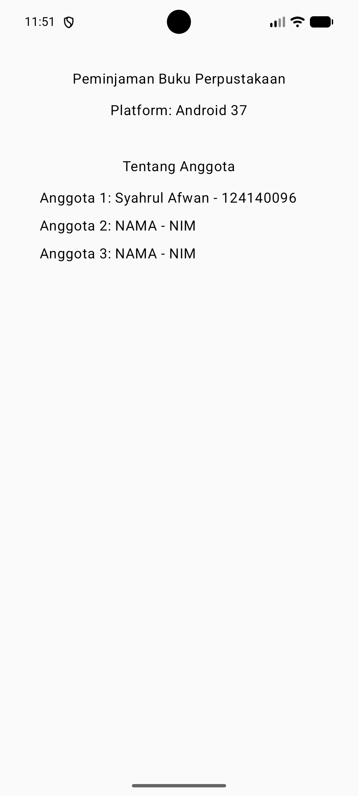

# PAM - Peminjaman Buku Perpustakaan

Proyek ini merupakan tugas mata kuliah **Pengembangan Aplikasi Mobile (IF25-22017)** - Teknik Informatika, Institut Teknologi Sumatera (ITERA).

Aplikasi ini dibangun menggunakan **Kotlin Multiplatform (KMP)** dan **Compose Multiplatform** untuk dapat berjalan di berbagai platform (Android, Desktop, iOS).

---

## 👥 Anggota Kelompok

| No | Nama | NIM | Peran |
|---|---|---|---|
| 1 | Syahrul Afwan | 124140096 | Ketua Kelompok |
| 2 | Hafidz Raihan Putra Anfa | 124140108 | Anggota |
| 3 | Jundi Lamtara | 124140190 | Anggota |

---

## 📱 Tampilan Aplikasi (Screenshot)

| Android | Desktop |
| :---: | :---: |
|  |  |

---

## 🛠️ Cara Menjalankan Proyek

### 1. Desktop (JVM)
Jalankan perintah berikut pada terminal di akar folder proyek:
```bash
./gradlew :composeApp:run