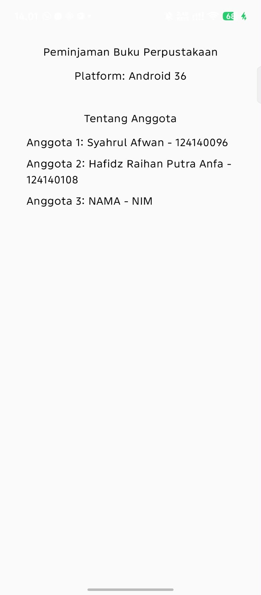
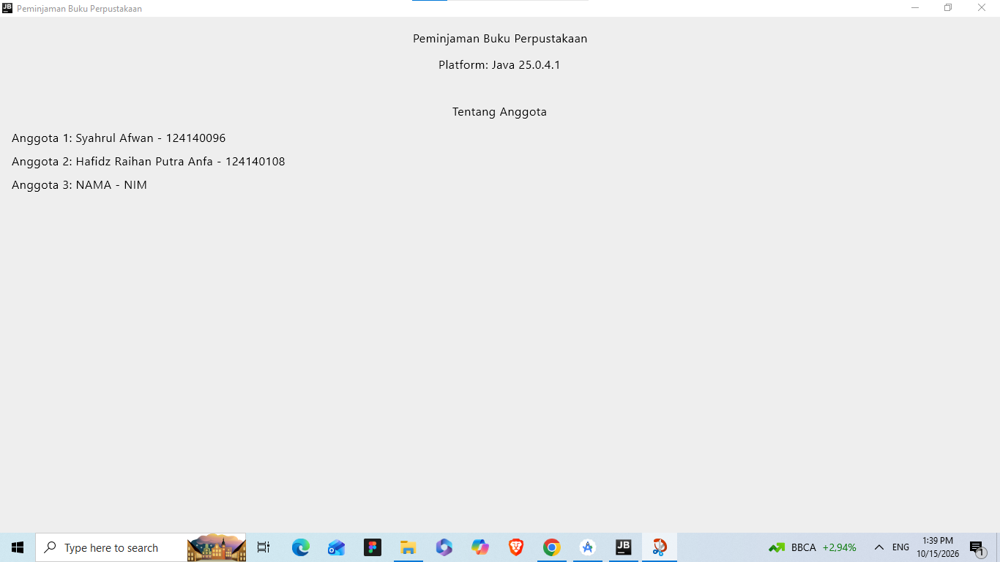

# Peminjaman Buku Perpustakaan

Proyek ini merupakan tugas mata kuliah **Pengembangan Aplikasi Mobile (IF25-22017)** - Teknik Informatika, Institut Teknologi Sumatera (ITERA).

Aplikasi ini dibangun menggunakan **Kotlin Multiplatform (KMP)** dan **Compose Multiplatform** untuk platform Android dan Desktop.

---

## Anggota Kelompok

| No | Nama | NIM | Peran |
|---|---|---|---|
| 1 | Syahrul Afwan | 124140096 | Ketua Kelompok |
| 2 | Hafidz Raihan Putra Anfa | 124140108 | Anggota |
| 3 | Jundi Lamtara | 124140190 | Anggota |

---

## Progres Pengerjaan Proyek

| Minggu | Topik / Fitur | Status | Catatan / Commit |
| :---: | --- | :---: | --- |
| 1 | Setup Proyek KMP & Tampilan Informasi Kelompok | Selesai | Kerangka KMP jalan di Android & Desktop |
| 2 | Model Data Peminjaman & Perubahan Status | Belum | - |
| 3 | Layar Daftar Buku & Peminjaman | Belum | - |
| 4 | Form Peminjaman Baru dengan ViewModel | Belum | - |
| 5 | Navigasi Antar Layar & Menu Bawah | Belum | - |
| 6 | Integrasi API / Data Server | Belum | - |
| 7 | Penyimpanan Lokal / Offline Mode | Belum | - |

---

## Tampilan Aplikasi

| Android | Desktop |
| :---: | :---: |
|  |  |

---

## Cara Menjalankan Proyek

### 1. Desktop (JVM)
```bash
./gradlew :desktopApp:run
```

### 2. Android
Jalankan modul `androidApp` melalui Android Studio atau terminal:
```bash
./gradlew :androidApp:installDebug
```
