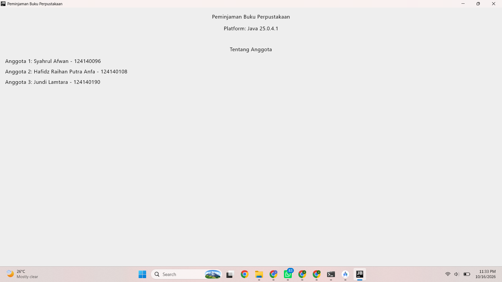

# Tema 17: Peminjaman Buku Perpustakaan

## Deskripsi Singkat Tema

Aplikasi peminjaman buku perpustakaan membantu mahasiswa mengajukan peminjaman
buku dan memantau statusnya, sehingga tidak perlu bertanya langsung ke petugas.
Setiap peminjaman melewati tiga tahap: **diajukan**, **dipinjam** (disetujui
petugas), lalu **dikembalikan**.

## Fokus Pengerjaan Pertemuan 1: Kenalan dengan KMP dan Siapkan Alat

Menyiapkan proyek KMP dari template Compose Multiplatform sampai bisa berjalan di
Android dan desktop, serta menampilkan nama tema, nama platform, dan informasi
anggota di layar.

## Anggota Kelompok

| No  | Nama                     | NIM       | Peran          |
| --- | ------------------------ | --------- | -------------- |
| 1   | Syahrul Afwan            | 124140096 | Ketua Kelompok |
| 2   | Hafidz Raihan Putra Anfa | 124140108 | Anggota        |
| 3   | Jundi Lamtara            | 124140190 | Anggota        |

## Pembagian Kerja

| Bagian                                                             | Penanggung jawab       |
| ------------------------------------------------------------------ | ---------------------- |
| Proyek KMP kelompok dari template Compose Multiplatform            | Kelompok               |
| Nama tema dan nama platform di layar                               | Kelompok               |
| Nama dan NIM di layar informasi kelompok (satu commit per anggota) | Syahrul, Hafidz, Jundi |

## 1. Proyek KMP Kelompok

Proyek dibuat dari template Compose Multiplatform, di-push ke repository
kelompok, dan bisa berjalan di dua target: Android dan desktop (JVM).

| Folder                      | Isinya                                                                             |
| --------------------------- | ---------------------------------------------------------------------------------- |
| `shared/src/commonMain`     | Kode untuk semua platform (`App.kt`, `Greeting`, `GreetingUtil.kt`, `Platform.kt`) |
| `shared/src/androidMain`    | Kode khusus Android                                                                |
| `shared/src/jvmMain`        | Kode khusus desktop (JVM)                                                          |
| `androidApp`                | Aplikasi Android                                                                   |
| `desktopApp`                | Aplikasi desktop                                                                   |
| `gradle/libs.versions.toml` | Daftar versi library                                                               |

Ide KMP yang dipakai: logika ditulis sekali di `commonMain`, sedangkan hal yang
khusus platform (misalnya nama platform) ditulis dengan `expect` di `commonMain`
dan `actual` di tiap platform.

## 2. Nama Tema di Layar

Judul aplikasi memakai nama tema, yaitu **Peminjaman Buku Perpustakaan**, dan
nama platform (Android atau Desktop JVM) ikut tampil di layar. Lihat bagian
tangkapan layar di bawah.

## 3. Satu Commit per Anggota

Setiap anggota melakukan commit sendiri dengan menambahkan nama dan NIM-nya di
layar informasi kelompok.

| Anggota                  | NIM       | Commit                         |
| ------------------------ | --------- | ------------------------------ |
| Syahrul Afwan            | 124140096 | (isi tautan atau pesan commit) |
| Hafidz Raihan Putra Anfa | 124140108 | (isi tautan atau pesan commit) |
| Jundi Lamtara            | 124140190 | (isi tautan atau pesan commit) |

## Tangkapan Layar

| Android                            | Desktop                           |
| ---------------------------------- | --------------------------------- |
|  |  |

## Cara Menjalankan

Di Windows (PowerShell), jalankan dari folder root proyek:

```powershell
# Desktop (paling cepat, tanpa emulator)
.\gradlew.bat :desktopApp:run

# Android (emulator atau HP tersambung)
.\gradlew.bat :androidApp:installDebug
```

Di Mac atau Linux, ganti `.\gradlew.bat` dengan `./gradlew`.
