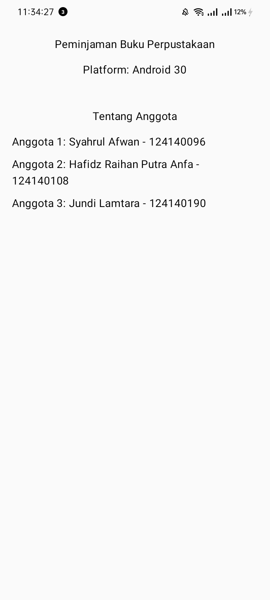

# Minggu 1: Kenalan dengan KMP dan Siapkan Alat

Tema 17: **Peminjaman Buku Perpustakaan**.
Proyek kelompok mata kuliah **IF25-22017 Pengembangan Aplikasi Mobile**
(Kotlin Multiplatform), Institut Teknologi Sumatera.
Checkpoint: **Pertemuan 1, Kenalan dengan KMP dan Siapkan Alat**.

## Deskripsi Singkat Tema

Aplikasi peminjaman buku perpustakaan membantu mahasiswa mengajukan peminjaman
buku dan memantau statusnya, sehingga tidak perlu bertanya langsung ke petugas
untuk tahu apakah pengajuan sudah diproses. Pada minggu 1 yang dibuat baru
kerangka aplikasinya: proyek KMP yang bisa dijalankan di Android dan desktop.

## Anggota Kelompok

| No | Nama                     | NIM       | Peran          |
|----|--------------------------|-----------|----------------|
| 1  | Syahrul Afwan            | 124140096 | Ketua Kelompok |
| 2  | Hafidz Raihan Putra Anfa | 124140108 | Anggota        |
| 3  | Jundi Lamtara            | 124140190 | Anggota        |

## Pembagian Kerja

| Checkpoint | Bagian | Penanggung jawab | Status |
|------------|--------|------------------|--------|
| 1 | Proyek KMP kelompok, dibuat dari template Compose Multiplatform dan di-push ke repository kelompok | Kelompok | Selesai |
| 2 | Nama tema di layar: judul aplikasi diganti nama tema, nama platform ikut tampil | Kelompok | Selesai |
| 3 | Satu commit per anggota: nama dan NIM masing-masing ditambahkan di layar informasi kelompok | Syahrul, Hafidz, Jundi | Selesai |

## Checkpoint 1: Proyek KMP Kelompok

Proyek dibuat dari template Compose Multiplatform dan bisa berjalan di dua target:
Android dan desktop (JVM).

| Folder | Isinya |
|--------|--------|
| `shared/src/commonMain` | Kode untuk semua platform (`App.kt`, `Greeting`, `GreetingUtil.kt`, `Platform.kt`) |
| `shared/src/androidMain` | Kode khusus Android |
| `shared/src/jvmMain` | Kode khusus desktop (JVM) |
| `androidApp` | Aplikasi Android |
| `desktopApp` | Aplikasi desktop |
| `gradle/libs.versions.toml` | Daftar versi library |

Ide KMP yang dipakai: logika ditulis sekali di `commonMain`, sedangkan hal yang
khusus platform (misalnya nama platform) ditulis dengan `expect` di `commonMain`
dan `actual` di tiap platform.

## Checkpoint 2: Nama Tema di Layar

Judul aplikasi memakai nama tema, yaitu **Peminjaman Buku Perpustakaan**, dan
nama platform (Android atau Desktop JVM) ikut tampil di layar. Lihat bagian
tangkapan layar di bawah.

## Checkpoint 3: Satu Commit per Anggota

Setiap anggota melakukan commit sendiri dengan menambahkan nama dan NIM-nya di
layar informasi kelompok.

| Anggota | NIM | Commit |
|---------|-----|--------|
| Syahrul Afwan | 124140096 | (isi tautan atau pesan commit) |
| Hafidz Raihan Putra Anfa | 124140108 | (isi tautan atau pesan commit) |
| Jundi Lamtara | 124140190 | (isi tautan atau pesan commit) |

## Tangkapan Layar

|                    Android                     |                    Desktop                     |
| :--------------------------------------------: | :--------------------------------------------: |
|  |  |

## Cara Menjalankan

Di Windows (PowerShell), jalankan dari folder root proyek:

```powershell
# Desktop (paling cepat, tanpa emulator)
.\gradlew.bat :desktopApp:run

# Android (emulator atau HP tersambung)
.\gradlew.bat :androidApp:installDebug
```

Di Mac atau Linux, ganti `.\gradlew.bat` dengan `./gradlew`.
