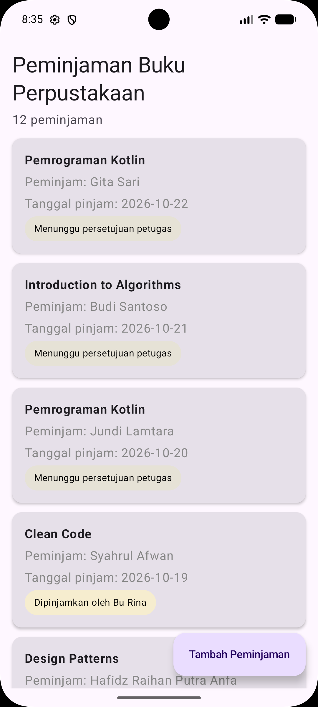
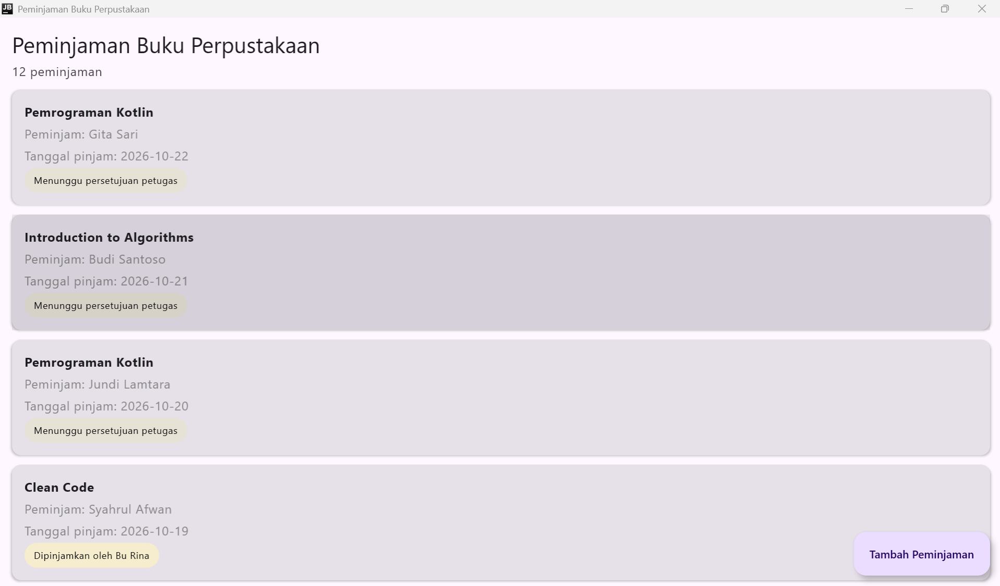

# Tema 17: Peminjaman Buku Perpustakaan

## Deskripsi Singkat Tema

Aplikasi peminjaman buku perpustakaan membantu mahasiswa mengajukan peminjaman
buku dan memantau statusnya, sehingga tidak perlu bertanya langsung ke petugas.
Setiap peminjaman melewati tiga tahap: **diajukan**, **dipinjam** (disetujui
petugas), lalu **dikembalikan**.

## Fokus Pengerjaan Pertemuan 3: Dasar Compose Multiplatform

Menampilkan data peminjaman sebagai layar daftar: kartu peminjaman dengan label
status berwarna, 12 data dummy yang diurutkan dari yang terbaru, dan tombol
"Tambah Peminjaman" yang belum berfungsi. Data masih berupa data palsu (dummy).

## Anggota Kelompok

| No  | Nama                     | NIM       | Peran          |
| --- | ------------------------ | --------- | -------------- |
| 1   | Syahrul Afwan            | 124140096 | Ketua Kelompok |
| 2   | Hafidz Raihan Putra Anfa | 124140108 | Anggota        |
| 3   | Jundi Lamtara            | 124140190 | Anggota        |

## Pembagian Kerja

| Bagian                            | Penanggung jawab         |
| --------------------------------- | ------------------------ |
| Kartu peminjaman dan label status | Hafidz Raihan Putra Anfa |
| Data dummy dan pengurutan         | Jundi Lamtara            |
| Layar daftar, FAB, dan README     | Syahrul Afwan            |

## 1. Kartu Peminjaman

Lokasi: `shared/src/commonMain/kotlin/org/example/project/ui/KartuPeminjaman.kt`

| Composable        | Isi                                                                                                                                                                           |
| ----------------- | ----------------------------------------------------------------------------------------------------------------------------------------------------------------------------- |
| `KartuPeminjaman` | `Card` berisi judul buku (tebal, satu baris, terpotong dengan elipsis), nama peminjam, tanggal pinjam, dan label status. Punya parameter `onKlik` dengan nilai bawaan kosong. |
| `LabelStatus`     | Label berbentuk pil dengan warna sesuai status, teksnya dari `label()` di model.                                                                                              |

Warna label status:

| Status         | Warna       | Teks label                      |
| -------------- | ----------- | ------------------------------- |
| `Diajukan`     | Abu krem    | Menunggu persetujuan petugas    |
| `Dipinjam`     | Kuning muda | Dipinjamkan oleh (nama petugas) |
| `Dikembalikan` | Hijau muda  | Dikembalikan: (isi catatan)     |

`when` pada `LabelStatus` memeriksa semua subtipe sealed class, sehingga kalau
nanti ada status baru, kompilator akan memberi tahu bagian yang perlu diubah.

## 2. Data Dummy

Lokasi: `shared/src/commonMain/kotlin/org/example/project/data/DaftarPeminjamanContoh.kt`

Berisi 10 buku dan 12 data peminjaman dengan campuran ketiga status. Daftar
yang ditampilkan (`daftarPeminjamanContoh`) diolah dengan fungsi koleksi:

| Fungsi                                    | Tujuan                                                                          |
| ----------------------------------------- | ------------------------------------------------------------------------------- |
| `sortedByDescending { it.tanggalPinjam }` | Peminjaman terbaru tampil paling atas                                           |
| `mapIndexed { ... copy(id = index + 1) }` | Id disusun ulang 1 sampai 12 supaya unik, dipakai sebagai `key` di `LazyColumn` |

## 3. Layar Daftar

Lokasi: `shared/src/commonMain/kotlin/org/example/project/App.kt`

| Bagian                         | Penjelasan                                                                                                             |
| ------------------------------ | ---------------------------------------------------------------------------------------------------------------------- |
| `Scaffold`                     | Kerangka layar, menampung FAB dan memberi `innerPadding` agar isi tidak tertutup status bar                            |
| `LazyColumn`                   | Menggambar kartu yang terlihat saja, `key = { it.id }`, jarak antarkartu 12 dp                                         |
| Judul                          | Satu `item` di awal daftar, memuat judul aplikasi dan jumlah peminjaman                                                |
| `contentPadding` bawah 88 dp   | Ruang untuk FAB agar kartu terakhir tidak tertutup                                                                     |
| `ExtendedFloatingActionButton` | Tombol "Tambah Peminjaman" di pojok kanan bawah, `onClick` sengaja kosong karena belum diwajibkan di modul pertemuan 3 |

Satu kode yang sama dipakai di Android dan desktop, keduanya memanggil `App()`
dari modul `shared`.

## Tangkapan Layar

| Android                                   | Desktop                                     |
| ----------------------------------------- | ------------------------------------------- |
|  |  |

## Cara Menjalankan

Buka proyek di Android Studio, lalu:

- **Android:** pilih konfigurasi `androidApp`, pilih perangkat atau emulator, lalu tekan Run.
- **Desktop**, jalankan di terminal:

```powershell
.\gradlew.bat :desktopApp:run
```
