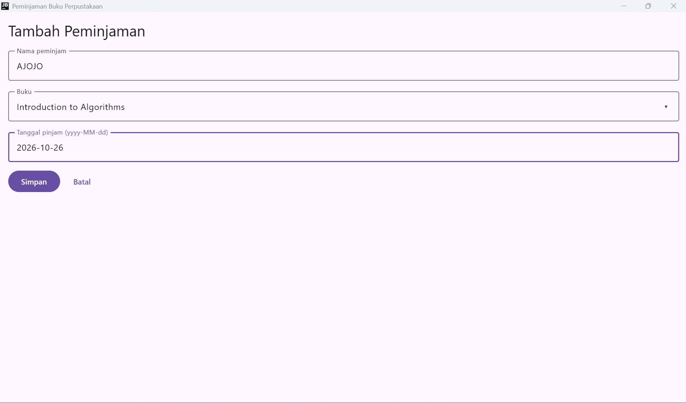
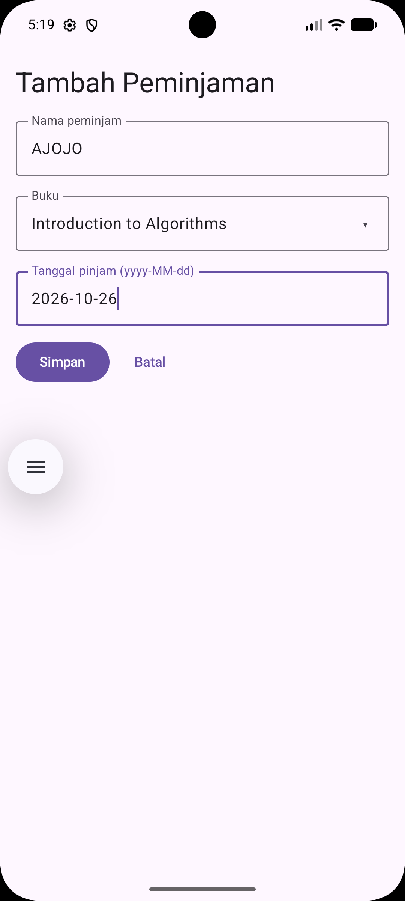
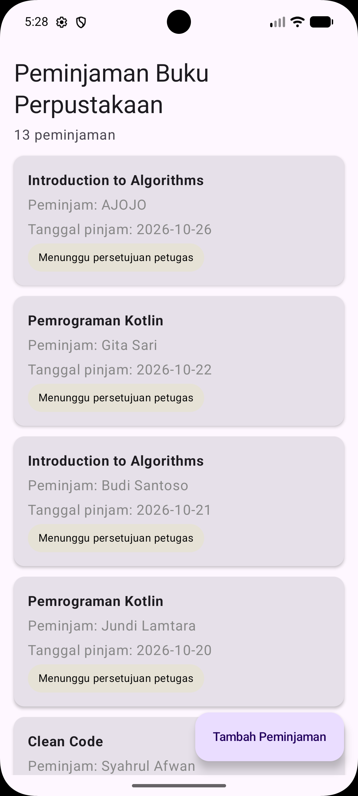
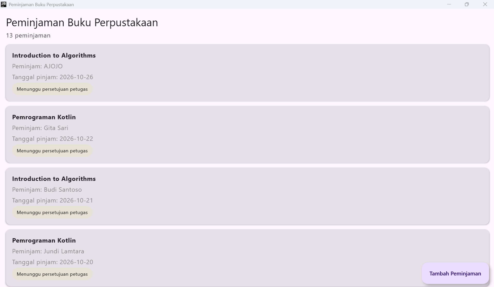

# Tema 17: Peminjaman Buku Perpustakaan

## Deskripsi Singkat Tema

Aplikasi peminjaman buku perpustakaan membantu mahasiswa mengajukan peminjaman
buku dan memantau statusnya, sehingga tidak perlu bertanya langsung ke petugas.
Setiap peminjaman melewati tiga tahap: **diajukan**, **dipinjam** (disetujui
petugas), lalu **dikembalikan**.

## Fokus Pengerjaan Pertemuan 4: State dan MVVM

Menambahkan form peminjaman yang bisa diketik dan isinya tetap utuh saat layar
diputar. State dan logika form dipindahkan ke ViewModel dengan StateFlow,
sedangkan layar hanya membaca state dan meneruskan aksi pengguna. Peminjaman
yang disimpan langsung muncul di layar daftar. Data masih berupa data palsu
yang disimpan di memori.

## Anggota Kelompok

| No  | Nama                     | NIM       | Peran          |
| --- | ------------------------ | --------- | -------------- |
| 1   | Syahrul Afwan            | 124140096 | Ketua Kelompok |
| 2   | Hafidz Raihan Putra Anfa | 124140108 | Anggota        |
| 3   | Jundi Lamtara            | 124140190 | Anggota        |

## Pembagian Kerja

| Bagian                                               | Penanggung jawab         |
| ---------------------------------------------------- | ------------------------ |
| Form tambah: KolomTeks, PemilihBuku, dan layar form  | Hafidz Raihan Putra Anfa |
| Sumber data daftar dan tes unit                      | Jundi Lamtara            |
| UiState, ViewModel, layar daftar, App.kt, dan README | Syahrul Afwan            |

## Alur MVVM

| Lapisan   | File                                                   | Tugas                                                           |
| --------- | ------------------------------------------------------ | --------------------------------------------------------------- |
| View      | `FormPeminjamanScreen`, `DaftarPeminjamanScreen`       | Membaca state dan meneruskan aksi pengguna, tanpa aturan bisnis |
| ViewModel | `FormPeminjamanViewModel`, `DaftarPeminjamanViewModel` | Menyimpan state, memvalidasi, dan memanggil sumber data         |
| Model     | `Peminjaman`, `Buku`, `SumberDaftarPeminjamanPalsu`    | Data class dan sumber data palsu                                |

Alur saat peminjaman disimpan:

1. Pengguna mengetik, `KolomTeks` memanggil `onValueChange`, lalu ViewModel
   memperbarui `uiState` (event naik).
2. `uiState` berubah, layar membacanya lewat `collectAsState()` dan digambar
   ulang (state turun).
3. Tombol Simpan memanggil `simpan()`, ViewModel memanggil `tambah()` pada
   sumber data.
4. Daftar di sumber data berubah, `DaftarPeminjamanScreen` otomatis menampilkan
   data baru di paling atas.

## 1. Form Tambah Peminjaman

Lokasi: `shared/src/commonMain/kotlin/org/example/project/ui/`

| Composable             | Isi                                                                                                                                                          |
| ---------------------- | ------------------------------------------------------------------------------------------------------------------------------------------------------------ |
| `KolomTeks`            | Kolom isian tanpa state (stateless). Menerima `label`, `value`, dan `onValueChange`. Dipakai untuk nama peminjam dan tanggal pinjam.                         |
| `PemilihBuku`          | Kolom bertanda ▾ yang membuka menu daftar buku. Buku terpilih datang dari parent, hanya status buka atau tutup menu yang disimpan di sini dengan `remember`. |
| `FormPeminjamanScreen` | Menyusun form, membaca `uiState`, dan meneruskan aksi ke ViewModel. Tidak ada aturan bisnis di dalamnya.                                                     |

State hoisting pada form ini mengikuti prinsip "state turun, event naik":

| Arah        | Contoh di kode                                                          |
| ----------- | ----------------------------------------------------------------------- |
| State turun | `state.peminjam` dikirim ke `KolomTeks` sebagai `value`                 |
| Event naik  | `KolomTeks` memanggil `onValueChange`, diteruskan ke `vm::ubahPeminjam` |

Isi `FormPeminjamanScreen`:

| Bagian                            | Penjelasan                                                                                                                                                    |
| --------------------------------- | ------------------------------------------------------------------------------------------------------------------------------------------------------------- |
| `Scaffold`                        | Memberi `innerPadding` agar judul form tidak tertimpa status bar                                                                                              |
| `verticalScroll` dan `imePadding` | Form bisa digulir dan tombol tidak tertutup keyboard                                                                                                          |
| Tombol Simpan                     | `enabled = state.bisaSimpan`, teksnya menjadi "Menyimpan" saat proses berjalan                                                                                |
| Tombol Batal                      | Memanggil `reset()` lalu `onBatal()`, nonaktif saat sedang menyimpan                                                                                          |
| `LaunchedEffect(state.tersimpan)` | Saat `tersimpan` menjadi true, form di-reset lalu layar kembali ke daftar. Pindah layar adalah efek samping, jadi tidak ditulis langsung di badan composable. |

## 2. UiState Form

Lokasi: `shared/src/commonMain/kotlin/org/example/project/ui/FormPeminjamanUiState.kt`

Satu data class berisi semua yang dibutuhkan layar form, dan setiap nilai punya
nilai bawaan.

| Properti          | Bawaan             | Fungsi                                                       |
| ----------------- | ------------------ | ------------------------------------------------------------ |
| `bukuDipilih`     | `null`             | Buku yang dipilih dari menu                                  |
| `peminjam`        | `""`               | Nama peminjam                                                |
| `tanggalPinjam`   | `""`               | Tanggal pinjam, format `yyyy-MM-dd`                          |
| `pilihanBuku`     | `daftarBukuContoh` | Daftar buku untuk menu, dibaca layar dari state              |
| `sedangMenyimpan` | `false`            | Penanda proses simpan sedang berjalan                        |
| `tersimpan`       | `false`            | Penanda simpan selesai, dibaca layar untuk kembali ke daftar |
| `pesan`           | `null`             | Disiapkan untuk pesan ke pengguna, belum dipakai             |

Dua properti berikut dihitung dari nilai lain dan tidak disimpan:

| Properti       | Aturan                                                                           |
| -------------- | -------------------------------------------------------------------------------- |
| `tanggalValid` | Cocok dengan bentuk `yyyy-MM-dd`                                                 |
| `bisaSimpan`   | Buku sudah dipilih, nama tidak kosong, tanggal valid, dan tidak sedang menyimpan |

Karena `bisaSimpan` dihitung, tombol Simpan tidak mungkin aktif saat form belum
lengkap.

## 3. ViewModel

Lokasi: `shared/src/commonMain/kotlin/org/example/project/ui/`

`FormPeminjamanViewModel`:

| Bagian                                        | Alasan                                                                                                                           |
| --------------------------------------------- | -------------------------------------------------------------------------------------------------------------------------------- |
| `_uiState` (`MutableStateFlow`, private)      | Hanya ViewModel yang boleh mengubah state                                                                                        |
| `uiState` (`StateFlow`, publik)               | Layar hanya bisa membaca                                                                                                         |
| `update { it.copy(...) }`                     | Mengganti objek lama dengan salinan baru                                                                                         |
| `take(50)` pada nama, `take(10)` pada tanggal | Membatasi panjang ketikan                                                                                                        |
| `simpan()`                                    | Keluar lebih awal bila `bisaSimpan` false, sehingga hanya data valid yang disimpan                                               |
| `sedangMenyimpan = true` sebelum `launch`     | Tombol langsung nonaktif, jadi tidak bisa ditekan dua kali                                                                       |
| `viewModelScope.launch` dan `delay(800)`      | Proses jalan di coroutine yang berhenti saat ViewModel dibersihkan. `delay` mensimulasikan proses kirim ke server.               |
| `reset()`                                     | Mengosongkan form dan membatalkan proses simpan yang masih berjalan. Perlu karena ViewModel tidak ikut hilang saat form ditutup. |

`DaftarPeminjamanViewModel` hanya meneruskan `daftar` dari sumber data dengan
tipe `StateFlow`, jadi layar daftar tidak bisa mengubahnya.

## 4. Sumber Data

Lokasi: `shared/src/commonMain/kotlin/org/example/project/data/`

| File                             | Isi                                                                                                             |
| -------------------------------- | --------------------------------------------------------------------------------------------------------------- |
| `SumberDaftarPeminjaman.kt`      | Interface dengan `daftar` (`StateFlow`) dan `tambah(buku, peminjam, tanggalPinjam)`                             |
| `SumberDaftarPeminjamanPalsu.kt` | Implementasi palsu, menyimpan daftar dalam `MutableStateFlow`, diisi 12 data awal dari `daftarPeminjamanContoh` |
| `DaftarPeminjamanContoh.kt`      | Ditambah `daftarBukuContoh` agar daftar buku bisa dipakai menu pilihan                                          |

Aturan `tambah()`:

| Aturan                  | Cara                                                                                                                        |
| ----------------------- | --------------------------------------------------------------------------------------------------------------------------- |
| Id unik                 | Id terbesar ditambah 1, bukan jumlah data ditambah 1                                                                        |
| Status awal             | `Diajukan`, dengan `tanggalKembali = null`                                                                                  |
| Urutan                  | Data baru diletakkan di depan lalu diurutkan dengan `sortedByDescending`, jadi data baru tetap di atas bila tanggalnya sama |
| Aman dipanggil berulang | Memakai `update { }` pada `MutableStateFlow`                                                                                |

Form dan daftar memakai satu instance bersama, `sumberDaftarPeminjaman`. Karena
belum ada dependency injection, ini yang membuat data dari form muncul di
layar daftar.

Tes unit: `shared/src/commonTest/.../data/SumberDaftarPeminjamanPalsuTest.kt`

| Yang diuji                                               |
| -------------------------------------------------------- |
| Id berikutnya adalah id terbesar ditambah 1              |
| Id pertama pada daftar kosong adalah 1                   |
| Id tetap unik setelah beberapa kali tambah               |
| Data baru ada di urutan paling atas                      |
| Data baru dengan tanggal sama tetap di atas data lama    |
| Daftar tetap terurut walau tanggal data baru paling lama |
| Jumlah daftar bertambah satu                             |
| Data baru berstatus `Diajukan` dan belum dikembalikan    |
| Data lama tidak berubah                                  |

## 5. Layar Daftar dan Perpindahan Layar

Lokasi: `shared/src/commonMain/kotlin/org/example/project/`

| File                           | Penjelasan                                                                                                                                                         |
| ------------------------------ | ------------------------------------------------------------------------------------------------------------------------------------------------------------------ |
| `ui/DaftarPeminjamanScreen.kt` | Layar daftar dari pertemuan 3, sekarang membaca data dari ViewModel dengan `collectAsState()`. Tombol "Tambah Peminjaman" memanggil `onTambah` sehingga berfungsi. |
| `App.kt`                       | Menyimpan `tampilkanForm` dengan `rememberSaveable`, lalu memilih antara layar daftar dan layar form                                                               |

`rememberSaveable` dipakai supaya form yang sedang terbuka tidak menutup sendiri
saat layar diputar. Perpindahan antar layar masih memakai state sederhana,
navigasi yang sebenarnya dibahas di pertemuan berikutnya.

## 6. Kebiasaan State dari Modul

| Kebiasaan                        | Di kode kami                                                |
| -------------------------------- | ----------------------------------------------------------- |
| State seminimal mungkin          | `bisaSimpan` dan `tanggalValid` dihitung, tidak disimpan    |
| Satu sumber kebenaran            | Isi form hanya ada di `FormPeminjamanViewModel`             |
| Hanya pemilik yang mengubah      | `MutableStateFlow` private, `StateFlow` publik              |
| Ubah dengan salinan              | `update { it.copy(...) }`, tidak mengubah objek lama        |
| Tanpa efek samping di composable | Simpan lewat ViewModel, pindah layar lewat `LaunchedEffect` |

## Tangkapan Layar

**Form terisi**

| Android                                                    | Desktop                                                    |
| ---------------------------------------------------------- | ---------------------------------------------------------- |
|  |  |

**Daftar setelah data ditambah**

| Android                                                        | Desktop                                                        |
| -------------------------------------------------------------- | -------------------------------------------------------------- |
|  |  |

## Cara Menjalankan

Buka proyek di Android Studio, lalu:

- **Android:** pilih konfigurasi `androidApp`, pilih perangkat atau emulator, lalu tekan Run.
- **Desktop**, jalankan di terminal:

```powershell
.\gradlew.bat :desktopApp:run
```

- **Tes unit**, jalankan di terminal:

```powershell
.\gradlew.bat :shared:jvmTest
```