# Tema 17: Peminjaman Buku Perpustakaan

## Deskripsi Singkat Tema

Aplikasi Peminjaman Buku Perpustakaan membantu mahasiswa mengajukan peminjaman buku dan memantau statusnya. Status peminjaman terdiri dari **Diajukan**, **Dipinjam**, dan **Dikembalikan**.

## Fokus Pengerjaan Pertemuan 5: Navigasi

Pertemuan 5 melanjutkan layar Daftar dan Form dari minggu 4. Navigasi menggunakan `NavHost` dengan lima rute bertipe. Setiap kartu di Daftar membuka Detail sesuai ID peminjaman. Menu bawah menghubungkan Beranda, Asisten, dan Profil.

## Anggota Kelompok

| No. | Nama                     | NIM       | Peran          |
| --- | ------------------------ | --------- | -------------- |
| 1   | Syahrul Afwan            | 124140096 | Ketua Kelompok |
| 2   | Hafidz Raihan Putra Anfa | 124140108 | Anggota        |
| 3   | Jundi Lamtara            | 124140190 | Anggota        |

## Pembagian Kerja

| Bagian                                                                                     | Penanggung Jawab         |
| ------------------------------------------------------------------------------------------ | ------------------------ |
| Rute bertipe, pengiriman ID dari Daftar, integrasi lima layar di `App.kt`, dan dokumentasi | Syahrul Afwan            |
| Menu bawah, pengaturan perpindahan tab, serta layar Asisten dan Profil                     | Hafidz Raihan Putra Anfa |
| Sumber data bersama, pencarian berdasarkan ID, ViewModel dan layar Detail, serta tes data  | Jundi Lamtara            |

## 1. Rute dan Peta Navigasi

`nav/Rute.kt` mendefinisikan rute dengan `@Serializable`. `App.kt` mendaftarkan kelima rute di `NavHost`, dengan Beranda sebagai layar awal.

| Rute             | Layar                  | Cara Membuka                      |
| ---------------- | ---------------------- | --------------------------------- |
| `RuteBeranda`    | Daftar Peminjaman      | Layar awal atau tab Beranda       |
| `RuteDetail(id)` | Detail Peminjaman      | Ketuk kartu peminjaman di Daftar  |
| `RuteForm`       | Form Tambah Peminjaman | Tekan Tambah Peminjaman di Daftar |
| `RuteAsisten`    | Asisten Perpustakaan   | Tab Asisten                       |
| `RuteProfil`     | Profil                 | Tab Profil                        |

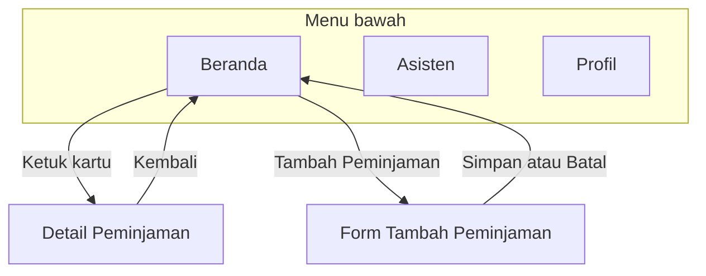

## 2. Detail dan Sumber Data

1. Saat kartu diketuk, `DaftarPeminjamanScreen.kt` meneruskan ID peminjaman lewat `onBukaDetail(id)`.
2. `App.kt` membuka `RuteDetail(id)` dan membaca ID tersebut dengan `toRoute<RuteDetail>()`.
3. `DetailPeminjamanViewModel.kt` memanggil `pantau(id)` dari `sumberDaftarPeminjaman`. Layar Detail menampilkan kondisi Memuat, data yang ditemukan, atau pesan jika ID tidak ditemukan.

Daftar, Form, dan Detail memakai sumber data yang sama. Peminjaman yang baru disimpan lewat Form dapat dibuka dari Daftar. ID peminjaman tetap sama saat daftar diurutkan ulang.

## 3. Menu Bawah

`MenuBawah.kt` menampilkan tab Beranda, Asisten, dan Profil serta menandai tab yang sedang aktif. Menu tampil di ketiga layar utama. Detail dan Form menggunakan navigasi kembali ke Daftar.

`PindahTab.kt` mengatur perpindahan tab dengan `popUpTo` agar riwayat tidak terus menumpuk. `launchSingleTop` mencegah tujuan teratas dibuat dua kali. `saveState` dan `restoreState` menyimpan serta memulihkan keadaan layar saat pengguna berpindah tab.

Asisten masih berupa tampilan awal. Profil menggunakan data contoh pengguna.

## Tangkapan Layar

| Layar                  | Android                                                                       | Desktop                                                                    |
| ---------------------- | ----------------------------------------------------------------------------- | -------------------------------------------------------------------------- |
| Daftar Peminjaman      | 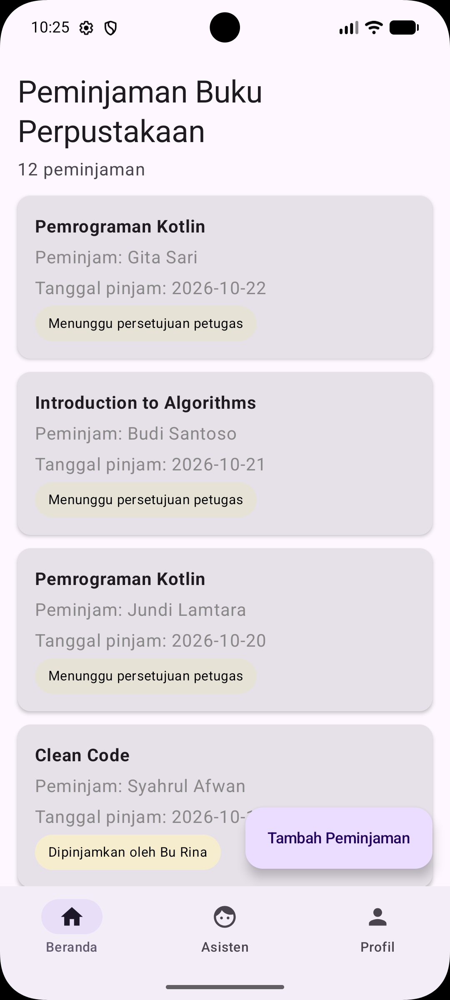   | 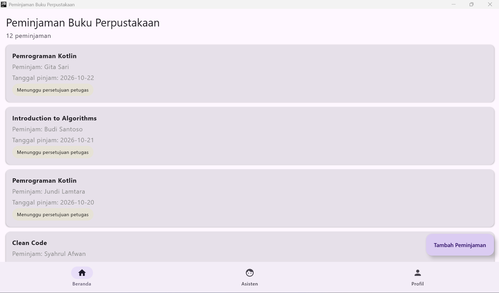   |
| Detail Peminjaman      | 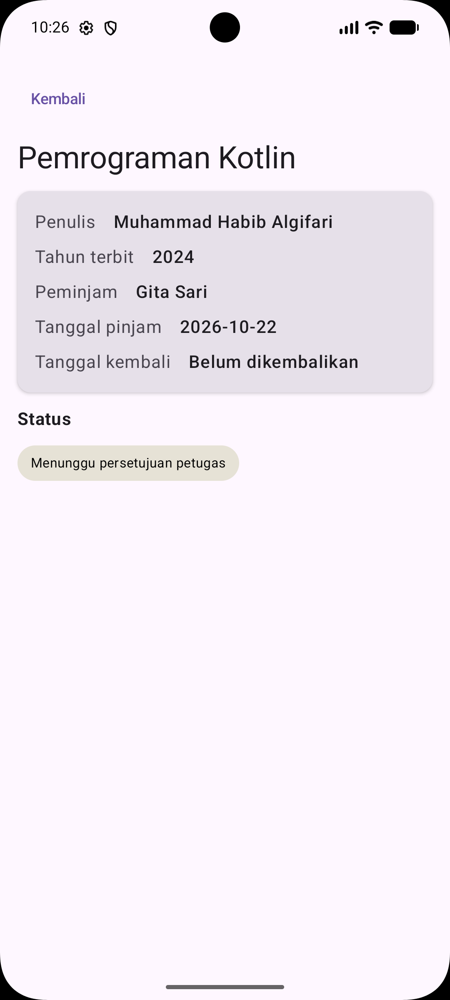   | 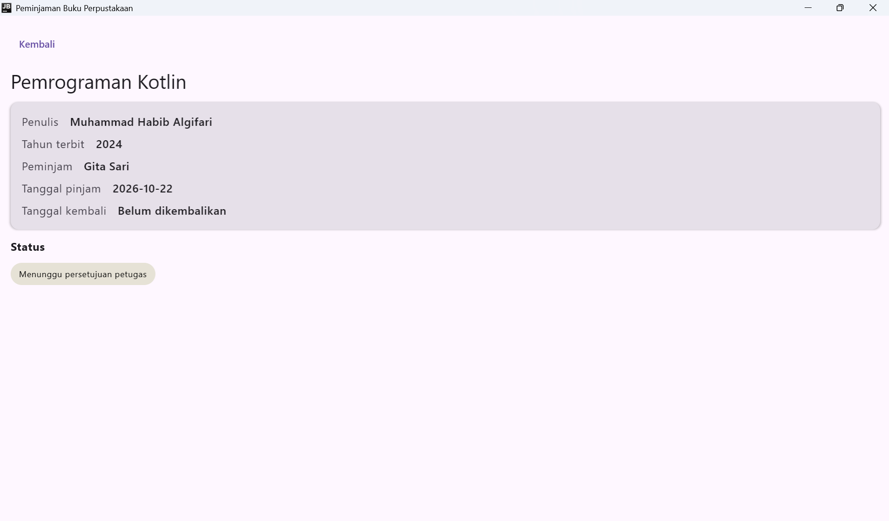   |
| Form Tambah Peminjaman | 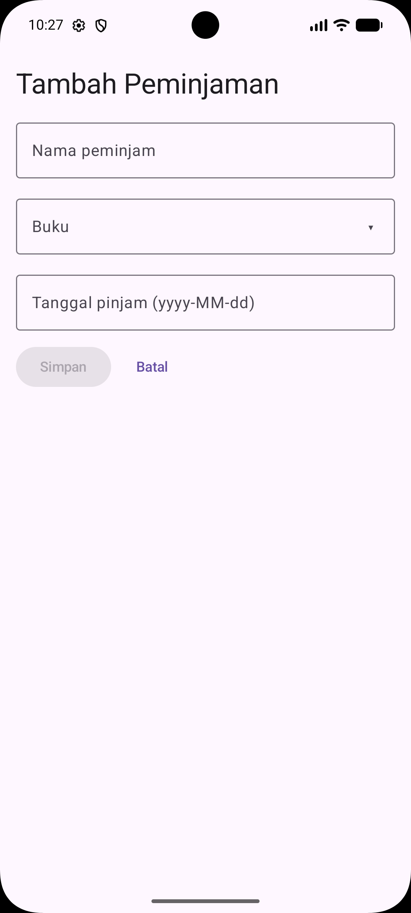       | 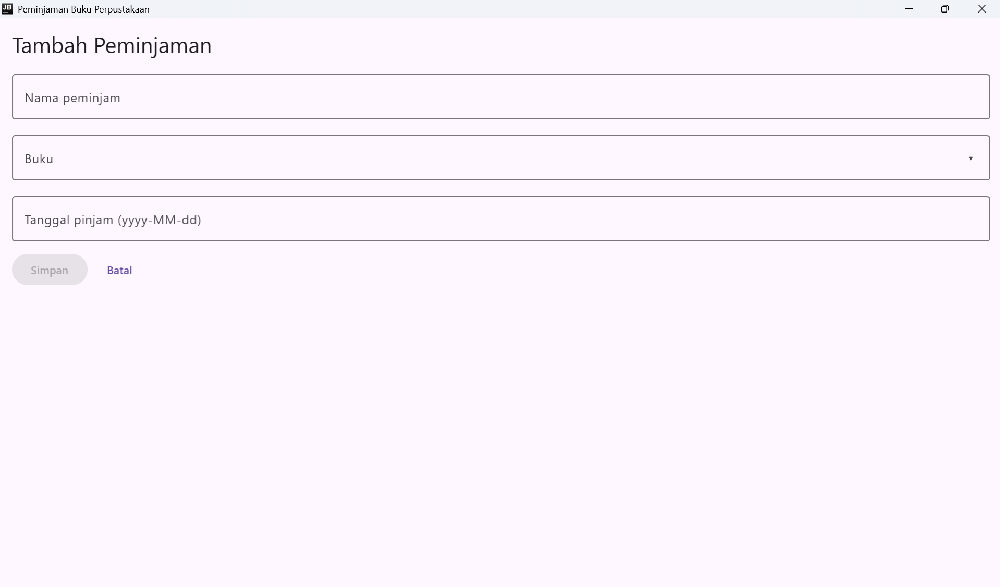       |
| Asisten Perpustakaan   | 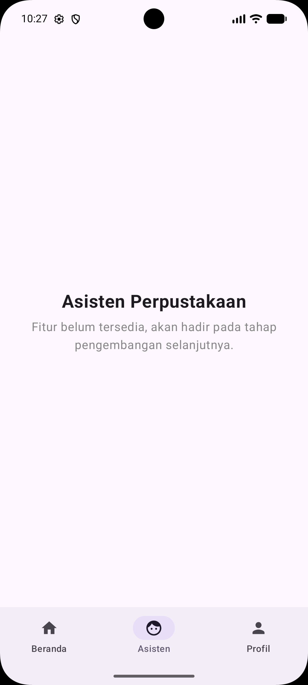 | 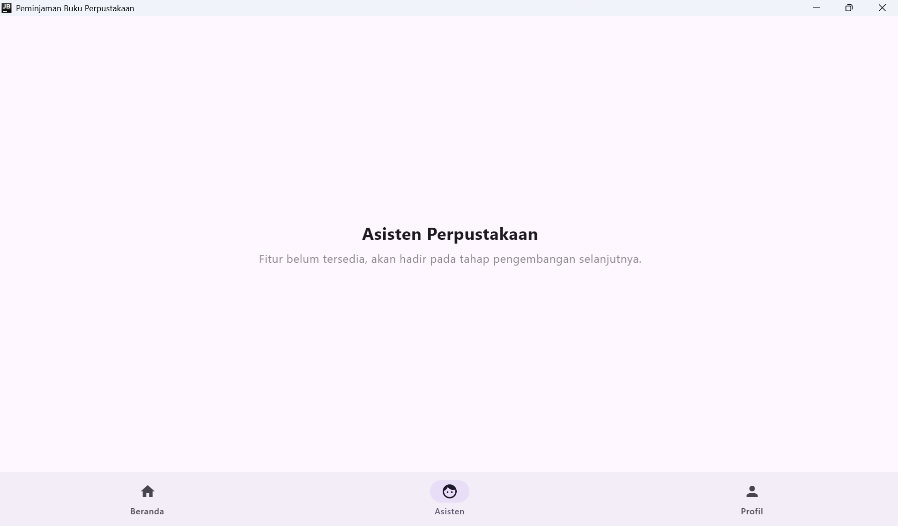 |
| Profil                 | 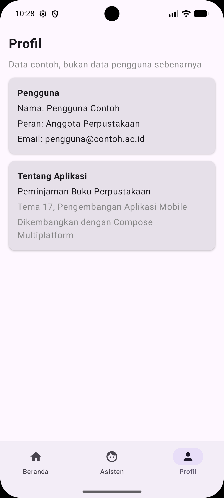   | 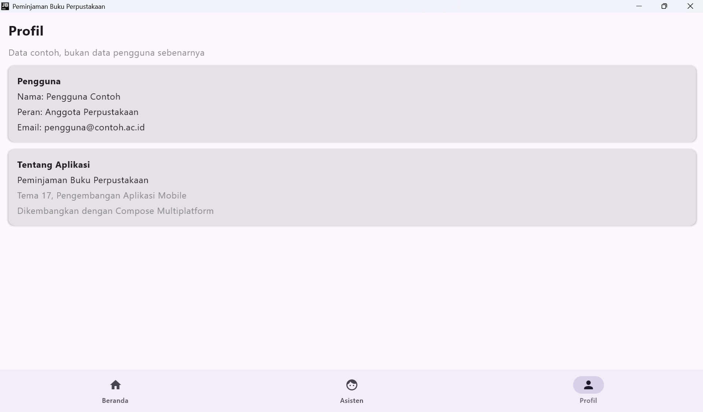   |

## Cara Menjalankan

Buka folder `minggu_05` di Android Studio dan tunggu sinkronisasi Gradle selesai.

- **Android** — pilih konfigurasi `androidApp`, pilih emulator atau perangkat, lalu tekan **Run**.
- **Desktop** — jalankan perintah berikut dari terminal Windows di folder `minggu_05`.

```powershell
.\gradlew.bat :desktopApp:run
```

Untuk menjalankan tes unit sumber data, gunakan perintah berikut.

```powershell
.\gradlew.bat :shared:jvmTest
```
